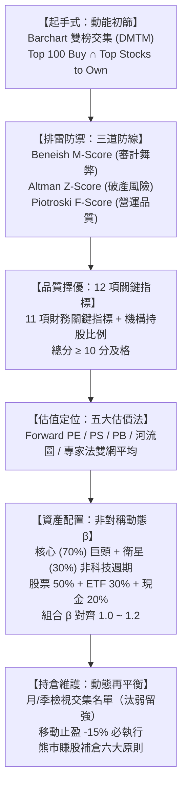

# 美股雙動能（DMTM）量化投資與資產配置全體系策略筆記

> **筆記依據**：完整彙整自美股實戰講座全套講義（`lecture_part01` 至 `lecture_part07`，共 66 頁）。  
> **核心宗旨**：融合「雙動能選股（DMTM）」、「三大防線財報排雷（M/Z/F-Score）」、「12 項關鍵指標品質評分」、「多維估價模型」、「核心／衛星與動態 $\beta$ 風控配置」以及「波段移動止損與熊市賺股再平衡」，建立高勝率、低波動、可嚴格執行的全天候美股投資系統。

---

## 視覺化導圖：美股四階段選股與動態 Beta 配置全流程圖 (A4 投影架構)

```mermaid
flowchart TD
    %% 全局沉穩高對比配色（適配投影與大螢幕教學）
    classDef titleStyle fill:#0F172A,stroke:#38BDF8,stroke-width:3px,color:#F8FAFC,font-weight:bold
    classDef passNode fill:#ECFDF5,stroke:#059669,stroke-width:2px,color:#064E3B,font-weight:bold
    classDef rejectNode fill:#FEF2F2,stroke:#DC2626,stroke-width:2px,color:#991B1B,font-weight:bold
    classDef warnNode fill:#FFFBEB,stroke:#D97706,stroke-width:2px,color:#92400E,font-weight:bold
    classDef coreNode fill:#EFF6FF,stroke:#2563EB,stroke-width:2px,color:#1E40AF,font-weight:bold
    classDef normalNode fill:#F8FAFC,stroke:#475569,stroke-width:1.5px,color:#0F172A

    TITLE["美股四階段量化選股與動態 β 資產配置全流程圖<br/>（A4 階層式 · 沉穩高對比投影導圖）"]:::titleStyle

    %% ================= 第一階段 =================
    subgraph S1 ["【第一階段】雙動能初篩（DMTM 起手式）"]
        direction TB
        S1_A["名單 A: Top 100 Stocks to Buy<br/>（Weighted Alpha 遞減加權綜合 · 動能最強暴衝飆股）"]:::normalNode
        S1_B["名單 B: Top Stocks to Own<br/>（13 項短中長指標 100% Buy 共識 · 長牛主流股）"]:::normalNode
        S1_JOIN{"取雙榜交集名單<br/>（既有暴衝動能 ＋ 又具完美多頭結構）"}:::coreNode
        S1_FAIL["未列入雙榜交集<br/>【直接剔除 / 不予納入】"]:::rejectNode
        S1_PASS["通過初篩：匯出雙榜交集清單 (.txt)<br/>（輸入 Barchart 監控 / 進入下一步 StockBoss 財報檢驗）"]:::passNode

        S1_A --> S1_JOIN
        S1_B --> S1_JOIN
        S1_JOIN -->|未重疊| S1_FAIL
        S1_JOIN -->|雙榜交集| S1_PASS
    end

    %% ================= 第二階段 =================
    subgraph S2 ["【第二階段】財報排雷與品質打分（三道防線 ＋ 12 項指標打分）"]
        direction TB
        S2_START["輸入交集清單進入 StockBoss 財報檢驗"]:::normalNode

        %% 第一道防線：M-Score
        M_CHECK{"第一道防線：審計排雷<br/>Beneish M-Score < -1.78 ?"}:::warnNode
        M_FAIL["Beneish M-Score ≥ -1.78<br/>【一票否決】涉嫌作假帳 / 財報操弄"]:::rejectNode

        %% 第二道防線：Z-Score
        Z_CHECK{"第二道防線：財務防守<br/>Altman Z-Score 檢驗"}:::warnNode
        Z_FAIL["Z-Score < 1.81<br/>【一票否決】破產風險區 / 財務危機"]:::rejectNode
        Z_GRAY["1.81 ≤ Z-Score ≤ 2.99<br/>【灰色警訊區】財務偏緊，標註待定"]:::warnNode
        Z_SAFE["Z-Score > 2.99<br/>【財務安全區】財務穩健，標註待定"]:::normalNode

        %% 第三道防線：F-Score
        F_CHECK{"第三道防線：營運品質確認<br/>Piotroski F-Score 檢驗"}:::warnNode
        F_FAIL["F-Score ≤ 3 分<br/>【一票否決】近期營運品質劣質"]:::rejectNode
        F_MID["4 ≤ F-Score ≤ 6 分<br/>【中等品質】營運尚可，進入指標評分"]:::normalNode
        F_PASS["F-Score ≥ 7 分<br/>【優質體質】營運卓越，進入指標評分"]:::passNode

        %% 12項財務指標打分矩陣
        SCORE_12{"第四步：12 項關鍵指標動態打分<br/>（11 項財務指標 ＋ 機構持股比例）"}:::coreNode
        SCORE_RULES["【評分門檻明細（總分需達到 10 分以上及格）】<br/>• 自由現金流(0~2分)：10年皆正(+1分)/近3~5年正(+0.5分)；10年持續成長(+1分)/近3~5年成長(+0.5分)<br/>• ROE(股東報酬)：10年都在15%~30%(1分)/10年均有15%(0.5分)/近3~5年改善接近15%(0.5分)；>30%或<15%(0分)<br/>• ROIC(資本報酬)：10年均≥10%~15%且高於WACC(1分)；近3~5年≥10%~15%且高於WACC(0.5分)<br/>• 營收成長率：10/5/3/1年皆高於20%~30%(1分)且越來越大(+1分)；5/3/1年高於20%~30%(0.5分)且越來越大(+0.5分)<br/>• EPS成長率：10/5/3/1年皆高於15%~20%(1分)且越來越大(+1分)；5/3/1年高於15%~20%(0.5分)且越來越大(+0.5分)<br/>• 營業利益率：10年向上且均≥15%(1分) / 3~5年(0.5分)<br/>• 淨利率：10年均≥20%(1分) / ≥10%或穩定向上(0.5分)<br/>• 負債權益比：最新一季 LT-Debt/Equity 低於 1.0(1分)<br/>• 利息保障倍數：TTM IC 高於 10倍(1分) / 高於 5倍(0.5分) / 無負債(1分)<br/>• 速動比率：TTM QR 高於 1.5(1分) / 高於 1.0(0.5分)<br/>• 回購殖利率：10年平均 ≥ 1.5%(1分) / 3~5年(0.5分)<br/>• 機構持股：美股≥90%(4分)/ADR≥60%(4分) 階梯遞減"]:::normalNode

        SCORE_EVAL{"12 項指標總分是否 ≥ 10 分 ?"}:::coreNode
        SCORE_FAIL["總分低於 10 分<br/>【淘汰】綜合競爭護城河不足"]:::rejectNode

        %% 最終倉等回頭判定 (結合 Z-Score)
        FINAL_TIER{"總分 ≥ 10 分通過品質驗證<br/>【回頭結合 Z-Score 判定最終倉等】"}:::coreNode
        TIER_NORMAL["前段 Z-Score > 2.99（安全區）<br/>【准予正常建倉 / 推薦建倉】<br/>（F-Score ≥ 7 推薦，4~6 常規建倉）"]:::passNode
        TIER_LIGHT["前段 1.81 ≤ Z-Score ≤ 2.99（灰色區）<br/>【僅准輕倉配置】<br/>（財務偏緊，嚴格控管部位上限）"]:::warnNode

        S2_START --> M_CHECK
        M_CHECK -->|M-Score ≥ -1.78 涉嫌舞弊| M_FAIL
        M_CHECK -->|M-Score < -1.78 安全通過| Z_CHECK

        Z_CHECK -->|Z < 1.81 破產風險| Z_FAIL
        Z_CHECK -->|1.81 ≤ Z ≤ 2.99 灰色警訊| Z_GRAY
        Z_CHECK -->|Z > 2.99 安全無虞| Z_SAFE

        Z_GRAY --> F_CHECK
        Z_SAFE --> F_CHECK

        F_CHECK -->|F-Score ≤ 3分 劣質| F_FAIL
        F_CHECK -->|4 ≤ F-Score ≤ 6分 中等| F_MID
        F_CHECK -->|F-Score ≥ 7分 優質| F_PASS

        F_MID --> SCORE_12
        F_PASS --> SCORE_12
        SCORE_12 --> SCORE_RULES
        SCORE_RULES --> SCORE_EVAL
        SCORE_EVAL -->|總分未達 10分 淘汰| SCORE_FAIL
        SCORE_EVAL -->|總分達標 ≥ 10分| FINAL_TIER

        FINAL_TIER -->|原 Z-Score > 2.99 安全| TIER_NORMAL
        FINAL_TIER -->|原 1.81 ≤ Z ≤ 2.99 灰色| TIER_LIGHT
    end

    %% ================= 第三階段 =================
    subgraph S3 ["【第三階段】個股多維估價與買點判定（合理估值錨定）"]
        direction TB
        VAL_SPLIT{"依標的產業與財務特徵分流估價"}:::coreNode

        V_LEADER["方塊 A：科技龍頭<br/>• 檢視 PE vs. Forward PE<br/>• 要求 Forward PE 低於 Trailing PE（具獲利成長空間）<br/>• 參考 (Trailing + Forward) / 2 折衷"]:::normalNode
        V_GROWTH["方塊 B：高成長股<br/>• 檢視 P/S vs. Forward P/S<br/>• 市銷率 PS 低於 5（微利／大量再投資期）<br/>• 與同行業競品進行橫向比較"]:::normalNode
        V_CYC["方塊 C：景氣週期股（MU, SNDK）<br/>• 不看 Forward，必看 PB！<br/>• 買入區間：PB 0.8 ~ 1.5（低於 0.8 菸屁股）"]:::normalNode
        V_BAND["方塊 D：非週期長牛股<br/>• 本益比 / 本淨比河流圖通道<br/>• -1SD 至 -2SD 低檔區間建倉"]:::normalNode
        V_EXP["方塊 E：權威投行專家法雙網校準<br/>• 高標 = (CNN High + SA High) / 2<br/>• 均標 = (CNN Med + SA Avg) / 2<br/>• 低標 = (CNN Low + SA Low) / 2"]:::normalNode

        VAL_DECISION{"估值結果評估：是否具備安全邊際？"}:::coreNode
        VAL_WAIT["股價嚴重高估 / 遠超合理價<br/>【列入觀察清單 · 暫緩建倉】"]:::warnNode
        VAL_READY["估值處於合理或低估區間<br/>【准予進入資產配置候選名單】"]:::passNode

        VAL_SPLIT --> V_LEADER
        VAL_SPLIT --> V_GROWTH
        VAL_SPLIT --> V_CYC
        VAL_SPLIT --> V_BAND
        VAL_SPLIT --> V_EXP

        V_LEADER --> VAL_DECISION
        V_GROWTH --> VAL_DECISION
        V_CYC --> VAL_DECISION
        V_BAND --> VAL_DECISION
        V_EXP --> VAL_DECISION

        VAL_DECISION -->|偏離過高 暫緩| VAL_WAIT
        VAL_DECISION -->|合理低估 准入| VAL_READY
    end

    %% ================= 第四階段 =================
    subgraph S4 ["【第四階段】資產配置與動態 β 風控模型（50/30/20 與 β 1.1~1.2）"]
        direction TB
        ALLOC_ROOT["總資產 100% 分配金字塔"]:::coreNode

        subgraph ALLOC_LAYERS ["資產三層架構"]
            direction LR
            LAYER_STOCK["【攻擊層：股票組合 50%】<br/>• 核心科技 (35% = 10檔 × 3.5%)<br/>• 衛星防禦 (15% = 5檔 × 3.0%)<br/>（生技 / 水務 / 航運 / 發電）"]:::coreNode
            LAYER_ETF["【基石層：大盤 ETF 30%】<br/>• 如 S&P 500 (VOO)<br/>• 基準 β = 1.0<br/>• 壓艙穩固市場基準收益"]:::normalNode
            LAYER_CASH["【救命繩：防禦現金 20%】<br/>• 無風險短債 / BOXX<br/>• 基準 β = 0.0<br/>• 保留大跌暴跌抄底子彈"]:::passNode
        end

        BETA_EQ["【動態 Beta 資產配置方程式】<br/>β_portfolio = (W_stocks × β_stocks) + (W_cash × 0) + (W_etf × 1.0)<br/>★ 實例算例：(50% × 1.662) + (20% × 0) + (30% × 1.0) = 1.131"]:::normalNode

        BETA_CHECK{"組合總體 β 風控檢驗"}:::coreNode
        BETA_PERFECT["1.1 ≤ β ≤ 1.2<br/>【黃金舒適區】收益與波動最佳平衡"]:::passNode
        BETA_ACCEPT["1.0 ≤ β 小於 1.1 或 1.2 小於 β ≤ 1.5<br/>【容許區間】合規但需微調部位"]:::warnNode
        BETA_DANGER["β 高於 1.5<br/>【嚴重超標！絕對禁止】<br/>波動過大，立即調增現金/ETF壓低β"]:::rejectNode

        ALLOC_ROOT --> LAYER_STOCK
        ALLOC_ROOT --> LAYER_ETF
        ALLOC_ROOT --> LAYER_CASH
        LAYER_STOCK --> BETA_EQ
        LAYER_ETF --> BETA_EQ
        LAYER_CASH --> BETA_EQ
        BETA_EQ --> BETA_CHECK
        BETA_CHECK -->|最佳舒適區| BETA_PERFECT
        BETA_CHECK -->|容許調整區| BETA_ACCEPT
        BETA_CHECK -->|超標警示| BETA_DANGER
    end

    %% ================= 執行與再平衡 =================
    subgraph S5 ["【執行與維護】持倉監控、波段止盈與季節性再平衡"]
        direction TB
        EXEC_STOP["買入之刻立即掛單：移動止盈/止損（Trailing Stop）<br/>★ 自最高點拉回 15% 必止盈止損！（SOXL 大跌高於15%，TQQQ高於8%）"]:::rejectNode
        EXEC_REBALANCE["定期再平衡（每 1 個月或每季檢視）<br/>• 跌出 Barchart 雙榜交集 ➔ 果斷剔除換股<br/>• 新晉前 10 名強勢標的 ➔ 替換納入"]:::coreNode
        EXEC_BUYBACK["熊市賺股補倉六大原則（止損是為了買更多）<br/>大盤企穩 ＋ 熟悉標的 ＋ 業績優良 ＋ 起漲線型 ＋ 大跌拉回 ＋ 出現 BUY 訊號"]:::passNode
        EXEC_SEASON["美股月份季節性作戰節奏<br/>• 進攻月份（買）：1, 3, 4, 7, 10, 11, 12 月<br/>• 防守月份（賣）：2 月（空窗拉回）、9 月（九月魔咒/Option避險）<br/>• 觀望月份（持有）：5, 6, 8 月"]:::warnNode

        EXEC_STOP --> EXEC_REBALANCE
        EXEC_REBALANCE --> EXEC_BUYBACK
        EXEC_BUYBACK --> EXEC_SEASON
    end

    %% 跨階段主流程銜接
    TITLE --> S1_JOIN
    S1_PASS --> S2_START
    TIER_NORMAL --> VAL_SPLIT
    TIER_LIGHT --> VAL_SPLIT
    VAL_READY --> ALLOC_ROOT
    BETA_PERFECT --> EXEC_STOP
    BETA_ACCEPT --> EXEC_STOP

    %% 連接線樣式
    linkStyle default stroke:#475569,stroke-width:1.5px
```



---

## 目錄導覽

1. [體系架構總覽（投資三部曲與決策漏斗）](#一體系架構總覽)
2. [第一階段：雙動能篩選（DMTM 起手式）](#二第一階段雙動能篩選dmtm-起手式)
3. [第二階段：財報排雷與品質驗證（三道防禦與 12 項關鍵指標）](#三第二階段財報排雷與品質驗證)
   - [2.1 三道防護網：M-Score、Z-Score、F-Score 門檻](#21-三道防護網排雷與品質驗證)
   - [2.2 決策矩陣表（建倉／輕倉／否決標準）](#22-初步篩選決策矩陣表)
   - [2.3 十二項關鍵財務指標具體打分標準（滿分制與及格門檻）](#23-十二項關鍵財務指標打分標準詳解)
4. [第三階段：個股多維估價觀察與判定（五大估價法）](#四第三階段個股多維估價觀察與判定)
5. [第四階段：資產配置與動態 $\beta$ 風控模型](#五第四階段資產配置與動態-beta-風控模型)
   - [4.1 核心／衛星非對稱配置架構（70 / 30 比例）](#41-核心衛星非對稱配置架構)
   - [4.2 總資產三層金字塔（50% 股票 / 30% ETF / 20% 現金）](#42-總資產三層金字塔結構)
   - [4.3 動態 $\beta$ 資產配置方程式與風控標準](#43-動態-beta-資產配置方程式)
6. [第五階段：持倉再平衡、波段止損與季節性作戰節奏](#六第五階段持倉再平衡波段止損與季節性操作)
   - [5.1 再平衡三大鐵律與週期](#51-持倉再平衡三大鐵律)
   - [5.2 移動止盈／止損機制（-15% 紀律）](#52-移動止盈止損機制)
   - [5.3 「牛市賺錢，熊市賺股」補倉六大原則](#53-牛市賺錢熊市賺股補倉法則)
   - [5.4 美股月份季節性特徵與月度操作指南](#54-美股全年度月份季節性規律)

---

## 一、體系架構總覽

依據講義第 2 頁目錄與第 7 頁核心定義，整體投資體系由以下三大維度緊密咬合：



- **雙動能投資三部曲（講義 p.7）**：
  1. **選擇投資標的**：雙贏篩選（動能交集 + 財務關鍵指標與機構持股 $\ge 10$ 分）。
  2. **估算合理價格**：依不同產業屬性（科技、成長、週期、金融）採取對應估價法。
  3. **波段操作與風控**：設定追蹤止損／止盈（高點拉回 -15%），汰弱留強，適時買回。

---

## 二、第一階段：雙動能篩選（DMTM 起手式）

> **講義出處**：第 8 頁至第 14 頁

### 1. 雙動能的核心定義（Dual Momentum）
傳統動能常面臨「短期暴衝但無基本面」或「長期績優但股價不動」的困境。本體系利用 Barchart 網站的兩份榜單取交集，鎖定「動能最強」與「結構最穩」的黃金重疊標的：

| 榜單名稱 | 核心篩選演算法／指標 | 榜單特性與選出標的特徵 | 講義備註 |
| :--- | :--- | :--- | :--- |
| **Top 100 Stocks to Buy**<br/>(前 100 檔最值得買入股票) | **加權 Alpha 值（Weighted Alpha）**<br/>時間遞減加權綜算法，強調近期動能加速 | 過去一年漲最多，且最近正在瘋狂加速噴發。<br/>看誰動能最猛（Alpha 最高），容易選出「**投機黑馬、暴衝飆股**」。 | 近一年漲最多、動能最強 |
| **Top Stocks to Own**<br/>(最頂級值得持有的股票) | **13 項經典技術指標共識**<br/>(包含 RSI, MACD, 移動平均線 MA 等) | 技術指標獲得 100% "Buy" 全面多頭共識。<br/>技術架構最完美，容易選出「**中大型主流股、趨勢長牛股**」。 | 技術指標技術面較強 |

### 2. 數據交集邏輯與操作流程
- **財富密碼交集**：一檔股票「既出現在 Top Stocks to Own（結構完美），同時又在 Top 100 Stocks to Buy 榜單中名列前茅（動能噴發）」。
- **操作步驟**：
  1. 至 Barchart 網站下載兩份名單（`Top 100 Stocks to Buy` 與 `Top Stocks to Own`）。
  2. 交付 AI 進行交集比對（提示詞：「*我給你兩份 EXCEL 檔，裡面有兩份股票名單，請你單純幫我比對兩份名單中重複的股票有哪些，謝謝*」）。
  3. 將比對出的重複名單另存為文字檔（`.txt`，每行一檔股票代碼）。
  4. 匯入富途牛牛（Futu 牛牛）軟體：自選股 $\to$ 分組管理 $\to$ 添加分組（如「牛頭雙動能」） $\to$ 導入股票（文字檔導入）。

---

## 三、第二階段：財報排雷與品質驗證

> **講義出處**：第 15 頁至第 48 頁

從雙動能篩選出來的交集清單，必須立刻送入財報排雷漏斗（使用 `Stockboss` 數據平台），執行嚴格的三道防禦審查。

### 2.1 三道防護網：排雷與品質驗證

```
【第一道防禦：審計排雷】 Beneish M-Score  < -1.78 （排除財報舞弊、假帳、虛增營收）
         ↓ 通過
【第二道防禦：財務防守】 Altman Z-Score   >  2.99 （排除破產風險、流動性危機）
         ↓ 通過
【第三道驗證：品質確認】 Piotroski F-Score ≥ 7    （確認近期營運品質與基本面改善）
```

- **第一道防線：Beneish M-Score（審計排雷）**
  - **安全標準**：$M\text{-Score} < -1.78$
  - **危險標準**：$M\text{-Score} \ge -1.78$。代表高機率存在財報粉飾、假營收或會計操弄，**一票否決，直接淘汰**。
- **第二道防線：Altman Z-Score（破產風險）**
  - **安全標準**：$Z\text{-Score} > 2.99$（財務超穩健）
  - **灰色地帶**：$1.81 \le Z\text{-Score} \le 2.99$（有財務壓力，僅可輕倉）
  - **危險標準**：$Z\text{-Score} < 1.81$。代表處於財務破產警訊邊緣，**一票否決，直接淘汰**。
- **第三道防線：Piotroski F-Score（營運品質）**
  - **優質標準**：$F\text{-Score} \ge 7$ 分（滿分 9 分，確認近四季營運效率、利潤率與償債能力全方位優質）
  - **中等標準**：$4 \le F\text{-Score} \le 6$ 分（營運普通，可作建倉觀察）
  - **劣質標準**：$F\text{-Score} \le 3$ 分（經營品質低下，排除）

---

### 2.2 初步篩選決策矩陣表

| Beneish M-Score | Altman Z-Score | Piotroski F-Score | 12 項關鍵指標總分 | 決策結果 | 策略定位 |
| :---: | :---: | :---: | :---: | :---: | :--- |
| **安全**（$<-1.78$） | **安全**（$>2.99$） | **優質**（$\ge 7$） | **$\ge 10$ 分** | **推薦建倉** | 高成長、高品質、高安全邊際主力 |
| **安全**（$<-1.78$） | **安全**（$>2.99$） | **中等**（$4 \sim 6$） | **$\ge 10$ 分** | **建倉** | 財務健康，基本面尚可之常規持股 |
| **安全**（$<-1.78$） | **灰色**（$1.81 \sim 2.99$） | **優質**（$\ge 7$） | **$\ge 10$ 分** | **輕倉** | 具備爆發力但財務槓桿較大，嚴控部位 |
| **危險**（$\ge -1.78$） | 任何情況 | 任何情況 | 任何情況 | **直接否決** | 涉嫌做假帳（如 IonQ M=2.62 否決） |
| 任何情況 | **危險**（$<1.81$） | 任何情況 | 任何情況 | **直接否決** | 破產危機（如 Ford Z=0.87 否決） |

---

### 2.3 十二項關鍵財務指標打分標準詳解

通過 M/Z/F-Score 初步檢驗後，採用「**動態趨勢分析法**」針對 7 大構面共 11 項關鍵財務指標加上機構持股比例（共 12 項）進行量化評分。  
**及格門檻**：總分必須 **$\ge 10$ 分**，才具備進入配置候選池資格！

#### 第 1 項：營業利益率（Operating Margin %）
- **核心構面**：企業成長構面／營運獲利效率
- **評分標準**：
  - 10 年趨勢往上、且 10 年平均 $\ge 15\%$ $\to$ **得 1 分**
  - 3～5 年趨勢往上、且 3～5 年平均 $\ge 15\%$ $\to$ **得 0.5 分**（浪子回頭型）

#### 第 2 項：自由現金流（Free Cash Flow - FCF）
- **核心構面**：現金流量構面（營業現金流 $-$ 資本支出）
- **評分標準**：
  - 自由現金流 10 年皆為正數 $\to$ **得 1 分**
  - 近 3～5 年自由現金流皆為正數 $\to$ **得 0.5 分**
  - 若 10 年自由現金流「持續成長」 $\to$ **再加 1 分**
  - 若近 3～5 年自由現金流「持續成長」 $\to$ **再加 0.5 分**

#### 第 3 項：淨利率（Net Margin %）
- **核心構面**：經營績效之獲利能力構面
- **評分標準**：
  - 10 年都大於（或平均）$20\%$ $\to$ **得 1 分**
  - 10 年都大於（或平均）$10\%$，或 10 年趨勢往上，或 10 年穩定 $\to$ **得 0.5 分**

#### 第 4 項：負債權益比（Debt to Equity / LT-Debt to Equity）
- **核心構面**：長期償債能力構面（避開負債累累的公司）
- **評分標準**：
  - 最新一季（TTM）長期負債／股東權益（LT-Debt/Equity）$< 1.0$ $\to$ **得 1 分**
  - 若 $\ge 1.0$ $\to$ **得 0 分**

#### 第 5 項：利息保障倍數（Interest Coverage - IC）
- **核心構面**：長期償債與付息能力
- **評分標準**：
  - 最新一季（TTM）IC $> 10$ 倍 $\to$ **得 1 分**（公司獲利足夠償還 10 年利息）
  - 最新一季（TTM）IC $> 5$ 倍 $\to$ **得 0.5 分**
  - 最新一季 IC 顯示為 `"-"`（公司完全無負債） $\to$ **得 1 分**

#### 第 6 項：股東權益報酬率（Return on Equity - ROE %）
- **核心構面**：經營績效之投資報酬構面（巴菲特最重視指標）
- **評分標準**：
  - 10 年的 ROE 都在 $15\% \sim 30\%$ 之間 $\to$ **得 1 分**
  - 10 年的 ROE 平均有 $15\%$ $\to$ **得 0.5 分**
  - 或近 3～5 年改善到接近上述標準 $\to$ **得 0.5 分**
- **講義核心警語與陷阱辨析**：
  - **穩定的 ROE 象徵經營團隊的穩定，不要超過 30%，15%～30% 最好！**
  - **ROE 太高通常有鬼，先抓股東權益！** 若公司大舉借債甚至負債超過資產，導致股東權益變成負值（如達美樂 DPZ、星巴克 SBUX、MSCI 曾因過度發債回購出現淨值為負），在 Stockboss 顯示 `"-"`，**一律給 0 分**並深入檢驗。
  - **杜邦方程式深入拆解**：
    $$\text{ROE} = \text{淨利率} \times \text{總資產周轉率} \times \text{財務槓桿（權益乘數）}$$
    $$\text{ROE} = \left(\frac{\text{淨收入}}{\text{營業收入}}\right) \times \left(\frac{\text{營業收入}}{\text{總資產}}\right) \times \left(\frac{\text{總資產}}{\text{股東權益}}\right)$$
    必須確認高 ROE 是來自高淨利（定價權）或高周轉（營運效率），而非過度槓桿借貸。

#### 第 7 項：投資資本報酬率（Return on Invested Capital - ROIC %）
- **核心構面**：經營績效之投資報酬構面（衡量利用所有投入資本創造獲利的效率，包含股東權益與有息負債）
- **評分標準**：
  - 10 年平均 $\ge 10\% \sim 15\%$ 且「均大於 WACC（加權平均資金成本）」 $\to$ **得 1 分**
  - 近 3～5 年平均 $\ge 10\% \sim 15\%$ 且「均大於 WACC」 $\to$ **得 0.5 分**
  - 註：ROIC 遠大於借貸利率，代表企業能有效利用外部資本賺取超額利潤（如講義註記：AMAT 越借越賺）。

#### 第 8 項：營收成長率（Revenue to Growth / 複合年均增長率 CAGR）
- **核心構面**：企業成長構面（複利營收擴張能力）
- **評分標準**：
  - 10 年、5 年、3 年、1 年增長率皆大於 $20\% \sim 30\%$ $\to$ **得 1 分**
  - 10 年、5 年、3 年、1 年增長率「越來越大」 $\to$ **再加 1 分**
  - 5 年、3 年、1 年增長率皆大於 $20\% \sim 30\%$ $\to$ **得 0.5 分**
  - 5 年、3 年、1 年增長率「越來越大」 $\to$ **再加 0.5 分**

#### 第 9 項：每股盈餘成長率（EPS Growth Rate / EPS without NRI）
- **核心構面**：股票評價構面（排除非經常性項目的每股真實獲利動能）
- **評分標準**：
  - 10 年、5 年、3 年、1 年皆大於 $15\% \sim 20\%$ $\to$ **得 1 分**
  - 10 年、5 年、3 年、1 年「越來越大」 $\to$ **再加 1 分**
  - 5 年、3 年、1 年皆大於 $15\% \sim 20\%$ $\to$ **得 0.5 分**
  - 5 年、3 年、1 年「越來越大」 $\to$ **再加 0.5 分**

#### 第 10 項：速動比率（Quick Ratio）
- **核心構面**：短期償債能力構面（剔除變現慢的存貨與預付款）
- **評分標準**：
  - 最新一季（TTM）Quick Ratio $> 1.5$ $\to$ **得 1 分**
  - 最新一季（TTM）Quick Ratio $> 1.0$ $\to$ **得 0.5 分**
  - 若 $\le 1.0$ $\to$ **得 0 分**

#### 第 11 項：股票回購殖利率（Shares Buyback Yield）
- **核心構面**：股票評價構面（回饋股東效率，Morningstar 指標）
- **評分標準**：
  - 10 年平均 $\ge 1.5\%$ $\to$ **得 1 分**
  - 3～5 年平均 $\ge 1.5\%$ $\to$ **得 0.5 分**
  - 無回購或低於標準 $\to$ **得 0 分**

#### 第 12 項：機構持股比例（Institutional Ownership）
- **核心意義**：美股是以機構法人為主導的市場，法人擁有最專業的調研團隊與第一手資料。「親兒子比乾兒子好」，以機構持股比例作為客觀量化護城河分數。
- **評分標準（講義 p.46）**：
  - **美國本土公司**：
    - 10 年平均 $\ge 90\%$ $\to$ **得 4 分**
    - 10 年平均 $\ge 80\%$ $\to$ **得 3 分**
    - 10 年平均 $\ge 70\%$ $\to$ **得 2 分**
    - 10 年平均 $\ge 60\%$ $\to$ **得 1 分**
    - $< 60\%$ $\to$ **得 0 分**
  - **ADR（海外存託憑證股票，如台積電 TSM）**：
    - 10 年平均 $\ge 60\%$ $\to$ **得 4 分**
    - 10 年平均 $\ge 50\%$ $\to$ **得 3 分**
    - 10 年平均 $\ge 40\%$ $\to$ **得 2 分**
    - 10 年平均 $\ge 30\%$ $\to$ **得 1 分**
    - $< 30\%$ $\to$ **得 0 分**

---

## 四、第三階段：個股多維估價觀察與判定

> **講義出處**：第 49 頁至第 58 頁  
> **核心哲學**：「散戶用股價思考，法人用獲利思考；越貴的股票越好。」（講義 p.49）

針對不同類型的股票，必須精準選用適當的估價方法，切忌一體適用：

| 估價方法 | 計算公式／核心指標 | 適用標的類型 | 具體及格與買入判斷標準 |
| :--- | :--- | :--- | :--- |
| **1. 本益比法 (PE)** | $\text{PE} = \frac{\text{股價}}{\text{EPS}}$ | 獲利穩定之大型龍頭股、七巨頭巨型企業 | • 美股一般合理區間在 **15 ～ 20 倍**。<br/>• 巴菲特價值標準：建議買進本益比 $< 15$ 倍之標的。<br/>• **科技大白馬／高速成長股**：不看歷史 PE，改看 **Forward PE（前瞻本益比）**；當 Forward PE 顯著低於 Trailing PE 時，表示未來獲利爆發空間大；亦可取 $\frac{\text{Trailing PE} + \text{Forward PE}}{2}$ 作為折衷評價。 |
| **2. 市銷率法 (PS)** | $\text{PS} = \frac{\text{股價}}{\text{每股營收}}$ | 成長初期、大量獲利再投資、折舊大導致微利或虧損的高成長股（如早期 Amazon、Tesla、AMD） | • 門檻標準：**PS 建議 $< 5$**。<br/>• 亦須與同行業競品進行橫向比較。適合用於評估成長階段沒有利潤或淨利極低的公司。 |
| **3. 市淨率法 (PB)** | $\text{PB} = \frac{\text{股價}}{\text{每股淨值}}$ | 最保守估價法。適用銀行、重資產、黃金、油井及**景氣週期股** | • **週期股宿命**（如記憶體巨頭 MU、SNDK 等）：**不用 Forward，必看 PB！**<br/>• 巴菲特偏好買入 **PB 在 0.8 ～ 1.5 之間**；PB $< 0.8$ 為極端便宜「撿菸屁股策略」。<br/>• 波克夏回購標準：當波克夏 PB $< 1.2$ 時啟動回購。<br/>• 系統性危機／金融海嘯來襲時，銀行、黃金、油井 PB 通常 $< 1$，為歷史性買點。 |
| **4. 河流圖法** | PE / PB Band（常態分佈河流圖通道） | 非週期型之長期穩定績優股 | • 觀察歷史區間通道。於「-1 到 -2 標準差（-1SD ~ -2SD）」之相對低檔區布局。<br/>• 週期股若產業循環已破壞則不適用。 |
| **5. 專家法 (Analyst)** | CNN Business ＋ Stock Analysis 雙來源目標價平均 | 全市場具備投行覆蓋之美股標的 | 採兩大權威網站綜合平均消除單一機構偏誤：<br/>• **高標價** $= \frac{\text{CNN High} + \text{SA High}}{2}$<br/>• **平均價** $= \frac{\text{CNN Median} + \text{SA Average}}{2}$<br/>• **低標價** $= \frac{\text{CNN Low} + \text{SA Low}}{2}$ |

---

## 五、第四階段：資產配置與動態 Beta 風控模型

> **講義出處**：第 60 頁至第 68 頁  
> **核心哲學**：「眼裡不要只有獲利，風險才是你要關心的，不要以為你扛得住下跌。」「絕對不清倉，不重倉（All-in），一定要保留現金。」

### 4.1 核心／衛星非對稱配置架構
在純股票投資籃子（100% 股票部位）內部，嚴格遵循「**70 / 30 非對稱動能結構**」：

- **核心（Core，佔股票籃子 70%）**：
  - **檔數**：**10 檔**大型股（壟斷型科技巨頭）。
  - **職責**：在牛市開疆闢土，極大化超額報酬（Alpha）。
- **衛星（Satellite，佔股票籃子 30%）**：
  - **檔數**：**5 檔**非科技週期的強勢股。
  - **領域範例**：生技醫藥（如 LQDA）、水務基建（如 NWPX）、航運物流（如 PSIG）、發電基建（如 WULF, HYLN）等。
  - **職責**：強迫組合進行結構性跨產業風險分散，阻斷單一科技板塊系統性殺跌。

---

### 4.2 總資產三層金字塔結構
落實到整體投資人總資產層次（講義 p.68 實例）：

```
┌─────────────────────────────────────────────────────────────┐
│ 【總資產 100% 配置架構】                                    │
├────────────────────────────────┬──────────────┬─────────────┤
│ 1. 攻擊層：個股配置 (50%)      │ 2. 基石層    │ 3. 救命繩   │
│   ├─ 核心科技 (35% = 10檔×3.5%)│   ETF (30%)  │   現金 (20%)│
│   └─ 衛星非科技(15% = 5檔×3.0%)│   (如 VOO)   │   (無風險/  │
│                                │              │    BOXX)    │
└────────────────────────────────┴──────────────┴─────────────┘
```

1. **攻擊層（股票部位 50%）**：
   - 核心部位（35%）：10 檔科技巨頭，每檔固定配置 **3.5%**（合計 35%）。
   - 衛星部位（15%）：5 檔非科技週期股，每檔固定配置 **3.0%**（合計 15%）。
2. **基石層（指數 ETF 30%）**：
   - 配置如 S&P 500 ETF（VOO），$\beta = 1.0$，提供市場基礎回報與壓艙石支撐。
3. **救命繩（防禦現金 20%）**：
   - 保持 20% 現金儲備（或放置於幾乎只漲不跌之極低風險資產，如 `BOXX` 或短期國債），$\beta = 0$，確保極端崩跌時擁有抄底生命線。

---

### 4.3 動態 Beta 資產配置方程式
- **目標波動值控制**：
  組合整體對標大盤之 $\beta$ 值應落在：
  $$\beta_{\text{portfolio}} \in [1.0, 1.5]$$
  - **黃金最佳區間**：**$1.1 \sim 1.2$（最佳舒適度）**。
  - **警戒極限**：**$1.5$ 為不可逾越之絕對上限**（$\beta > 1.5$ 波動過大，崩跌時組合將承受毀滅性回撤）。
- **資產配置方程式**：
  $$\beta_{\text{portfolio}} = W_{\text{stocks}} \times \beta_{\text{stocks}} + W_{\text{cash}} \times \beta_{\text{cash}} + W_{\text{etf}} \times \beta_{\text{etf}}$$
  - $W_{\text{stocks}} + W_{\text{cash}} + W_{\text{etf}} = 100\%$
  - 現金之 $\beta_{\text{cash}} \equiv 0$
  - 大盤 ETF 之 $\beta_{\text{etf}} \equiv 1.0$
- **講義實際算例驗證（p.68）**：
  設股票部位加權 $\beta_{\text{stocks}} = 1.662$，配置權重為股票 50%、現金 20%、VOO 30%：
  $$\beta_{\text{portfolio}} = (50\% \times 1.662) + (20\% \times 0) + (30\% \times 1.0)$$
  $$\beta_{\text{portfolio}} = 0.831 + 0 + 0.300 = \mathbf{1.131}$$
  計算結果為 **$1.131$**，精準落在 $1.1 \sim 1.2$ 的黃金最優配置區間！

---

## 六、第五階段：持倉再平衡、波段止損與季節性操作

> **講義出處**：第 7 頁、第 8 頁、第 60 頁、第 67 頁、第 69 頁

### 5.1 持倉再平衡三大鐵律

1. **定期再平衡（Risk Parity）**：
   - 秉持「紀律、紀律、紀律」，定期透過調整現金與 ETF 比例，確保整體投資組合之 $\beta$ 值精準對齊大盤目標值（$\beta \approx 1.1 \sim 1.2$）。
2. **定期汰弱留強（動能置換）**：
   - 動能具有時效性，**每 1 個月或每季度**重新比對 Barchart 雙榜交集名單。
   - **剔除條件**：一旦原持股**跌出交集名單，直接換掉**，絕不戀戰。
   - **納入條件**：新衝進前 10 名之高動能優質黑馬換進來補充部位。
3. **移動止盈／止損設計（-15% 鐵律）**：
   - 對每一檔持倉股票嚴格設定「移動追蹤止損／止盈（Trailing Stop）」。
   - **自最高點拉回 15% 必止盈／止損出局！**

---

### 5.2 移動止盈／止損機制

- **執行紀律**：「**買下之刻設好！必等！**」（講義 p.7 手寫強調）。
- **數學根基（正負報酬不對稱性，講義 p.60）**：
  - 虧損 -5% 需漲 5% 回本；虧損 -10% 需漲 11%；虧損 -15% 需漲 18%。
  - 一旦虧損擴大至 -30% 需漲 43%；虧損 -50% 需漲 100%；虧損 -75% 需漲 300%；虧損 -90% 需漲 900%！
  - 15% 是控制虧損、保護本金且不被正常市場隨機雜訊輕易洗出場的最佳平衡閥值。
- **高槓桿 ETF 特殊閥值（講義 p.8 筆記）**：
  - 一般個股／強勢股：拉回 15% 止損。
  - 3 倍槓桿半導體（SOXL）：超過 15% 大跌必果斷處理。
  - 3 倍那斯達克（TQQQ）：拉回 8% 即須提高警戒與處理。

---

### 5.3 「牛市賺錢，熊市賺股」補倉法則

> **核心思想**：止損並非看空離場，而是為了在高位鎖定利潤、保留充裕現金，等待市場非理性大跌時，以更低價格「買回更多股數」！（講義 p.8）

#### 補倉六大檢驗維度（嚴格遵守矩陣）

| 檢驗維度 | 准予補倉條件（BUY） | 嚴禁補倉條件（STOP） |
| :--- | :--- | :--- |
| **1. 大盤環境** | 大盤**企穩時**才補 | 大盤動盪不穩、持續下殺破底時**不補** |
| **2. 標的股性** | **熟悉的標的**才補（講義註：鎖定核心 5 檔熟悉龍頭做對沖） | 不熟悉的投機雜毛**不補** |
| **3. 企業業績** | 財報**業績優良、基本面無虞**者才補 | 業績下滑、暴雷或被降評者**不補** |
| **4. 線型走勢** | 股價**止跌築底、起漲時**才補 | 趨勢破位、破支撐下殺時**不補** |
| **5. 漲跌時點** | 順應大跌拉回、安全邊際出現時才補 | 剛大漲急拉噴出時**不追補** |
| **6. 技術指標** | 指標出現明確 **BUY 買入訊號**才補 | 指標為 SELL 或左側盲目猜底時**都不准補** |

---

### 5.4 美股全年度月份季節性規律

> **講義出處**：第 69 頁《美股歷史統計與季節性特徵表》

美股機構法人受財報發布季、季末結算作帳、退稅與假期作息影響，全年度具有高度規律的季節性節奏：

```
1月 (買) ─→ 2月 (賣) ─→ 3月 (買) ─→ 4月 (買) ─→ 5月 (持有) ─→ 6月 (持有)
 └ 一月效應   └ 財報空窗   └ 季末作帳   └ 黃金開跑     └ Sell in May  └ 年中盤整
 
7月 (買) ─→ 8月 (持有) ─→ 9月 (賣) ─→ 10月 (買) ─→ 11月 (買) ─→ 12月 (買)
 └ 夏季拉升   └ 假期量縮   └ 九月魔咒   └ 轉折築底    └ 最強波段    └ 聖誕行情
```

| 月份 | 平均報酬率 | 勝率 | 季節性市場特徵（講義原文） | 建議操作策略 |
| :---: | :---: | :---: | :--- | :---: |
| **1 月** | **+1.10%** | **61%** | **一月效應**：機構新一年的資金重新建倉佈局。 | **買** |
| **2 月** | **-0.10%** | **53%** | **財報空窗／拉回**：第四季財報發布完畢，市場缺乏新催化劑。 | **賣**（防禦減碼） |
| **3 月** | **+1.10%** | **64%** | **Q1 季末作帳**：法人機構進行第一季績效結算與再平衡。 | **買** |
| **4 月** | **+1.50%** | **70%** | **美股黃金期**：第一季財報開跑，退稅資金注入市場。 | **買** |
| **5 月** | **+0.30%** | **59%** | **Sell in May**：夏季交投漸趨淡靜，資金動能放緩。 | **持有** |
| **6 月** | **+0.20%** | **55%** | **年中盤整**：上半年結算，觀望下半年宏觀展望。 | **持有** |
| **7 月** | **+1.60%** | **62%** | **夏季拉升**：第二季財報季啟動，獲利帶動上攻。 | **買** |
| **8 月** | **+0.10%** | **54%** | **假期量縮**：華爾街主力交易員夏季休假，流動性下降、波動放大。 | **持有** |
| **9 月** | **-0.80%** | **45%** | **九月魔咒**：**全年唯一平均報酬為負且勝率過半未達之月份**。（講義手寫提示：9 月第一週可採用 Option 選擇權試單避險） | **賣**（防守避險） |
| **10 月** | **+0.80%** | **60%** | **熊市殺手／轉折月**：歷史上諸多崩盤發生於此，但也常為強烈反轉築底區。 | **買** |
| **11 月** | **+1.70%** | **69%** | **最強波段**：大選年催化、Q3 財報尾聲，法人建倉與年底作帳行情啟動。 | **買** |
| **12 月** | **+1.40%** | **73%** | **聖誕老人行情**：節慶消費氣氛與法人封關作帳。 | **買** |

---

## 七、全流程實戰執行檢查清單（SOP Check-List）

每次進場與調倉，請依序對照以下步驟：

- [ ] **步驟 1：Barchart 雙榜交集（動能初選）**
  - 下載 `Top 100 Stocks to Buy` 與 `Top Stocks to Own`，比對出交集股票。
- [ ] **步驟 2：Stockboss 財報排雷（三道防禦）**
  - Beneish M-Score $< -1.78$？（否則一票否決）
  - Altman Z-Score $> 2.99$？（若 $< 1.81$ 一票否決，若 $1.81 \sim 2.99$ 僅限輕倉）
  - Piotroski F-Score $\ge 7$ 分？（$4 \sim 6$ 分列入觀察）
- [ ] **步驟 3：12 項關鍵指標打分（品質擇優）**
  - 營業利益率、自由現金流、淨利率、負債權益比、利息保障倍數、ROE、ROIC、營收成長率、EPS 成長率、速動比率、回購殖利率、機構持股比例。
  - 總分是否 $\ge 10$ 分？（及格方可入選）
- [ ] **步驟 4：估值檢驗與買點評估**
  - 科技成長股：檢視 Forward PE 與 PS（$< 5$）。
  - 週期／重資產股：檢視 PB 區間（$0.8 \sim 1.5$）。
  - 專家目標價：比對 CNN Business 與 Stock Analysis 之平均高／中／低點。
- [ ] **步驟 5：投資組合配置與 Beta 校準**
  - 總部位：股票 50%（核心科技 10 檔佔 35% + 衛星非科技 5 檔佔 15%）、ETF 30%、現金 20%。
  - 驗算組合總體 $\beta$，確保落於 $1.1 \sim 1.2$（上限不超過 1.5）。
- [ ] **步驟 6：下單與掛設止盈**
  - **買下之刻立刻掛設拉回 15% 之移動止盈（Trailing Stop）**。
- [ ] **步驟 7：月度與季度再平衡維護**
  - 跌出 Barchart 交集名單者果斷剔除換股。
  - 參考月份季節性規律（特別留意 2 月與 9 月之賣出／避險節奏）。
  - 若遇大盤修正，依「大盤穩、股性熟、業績好、線型起漲、指標 BUY」之原則執行熊市賺股補倉。
